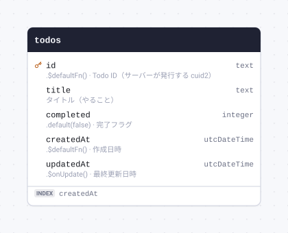

# Schema docs


<details>
<summary>The whole schema as SQL</summary>

```sql
CREATE TABLE `todos` (
	`id` text PRIMARY KEY,
	`title` text NOT NULL,
	`completed` integer DEFAULT false NOT NULL,
	`createdAt` datetime NOT NULL,
	`updatedAt` datetime NOT NULL
);

CREATE INDEX `todos_createdAt_idx` ON `todos` (`createdAt`);
```

</details>

## Contents

| Table                 | Name in the database | Description |
| --------------------- | -------------------- | ----------- |
| [todos](#table-todos) | `todos`              |             |

## Tables

<a id="table-todos"></a>

### todos



| Column      | Type          | Constraints | Default           | Description                         |
| ----------- | ------------- | ----------- | ----------------- | ----------------------------------- |
| `id`        | `text`        | PK NOT NULL | `.$defaultFn()`   | Todo ID（サーバーが発行する cuid2） |
| `title`     | `text`        | NOT NULL    |                   | タイトル（やること）                |
| `completed` | `integer`     | NOT NULL    | `.default(false)` | 完了フラグ                          |
| `createdAt` | `utcDateTime` | NOT NULL    | `.$defaultFn()`   | 作成日時                            |
| `updatedAt` | `utcDateTime` | NOT NULL    | `.$onUpdate()`    | 最終更新日時                        |

#### Definition

```sql
CREATE TABLE `todos` (
	`id` text PRIMARY KEY,
	`title` text NOT NULL,
	`completed` integer DEFAULT false NOT NULL,
	`createdAt` datetime NOT NULL,
	`updatedAt` datetime NOT NULL
);

CREATE INDEX `todos_createdAt_idx` ON `todos` (`createdAt`);
```

#### Indexes

- INDEX `createdAt`

<details>
<summary>Queries and their SQL</summary>

**Select**: Every row of todos.

```ts
db.select().from(todos);
```

```sql
select "id", "title", "completed", "createdAt", "updatedAt"
from "todos"
```

**Count**: How many rows todos has.

```ts
db.select({ count: count() }).from(todos);
```

```sql
select count(*)
from "todos"
```

**Find many**: The rows of todos, through the relational query API.

```ts
db.query.todos.findMany();
```

```sql
select "d0"."id" as "id", "d0"."title" as "title", "d0"."completed" as "completed", "d0"."createdAt" as "createdAt", "d0"."updatedAt" as "updatedAt"
from "todos" as "d0"
```

**Find by primary key**: One row of todos, through the relational query API.

```ts
db.query.todos.findFirst({ where: { id: "id" } });
```

```sql
select "d0"."id" as "id", "d0"."title" as "title", "d0"."completed" as "completed", "d0"."createdAt" as "createdAt", "d0"."updatedAt" as "updatedAt"
from "todos" as "d0"
where "d0"."id" = ?
limit ?
-- params: ["id",1]
```

**Insert**: Adds a row to todos, giving the columns that have no default.

```ts
db.insert(todos).values({ title: "title", updatedAt: "updatedAt" });
```

> drizzle-orm could not build its SQL: value.toISOString is not a function

**Update**: Changes a row of todos, found by its primary key.

```ts
db.update(todos).set({ title: "title" }).where(eq(todos.id, "id"));
```

```sql
update "todos"
set "title" = ?, "updatedAt" = ?
where "todos"."id" = ?
-- params: ["title","2026-01-01T00:00:00.000+00:00","id"]
```

**Delete**: Deletes a row of todos, found by its primary key.

```ts
db.delete(todos).where(eq(todos.id, "id"));
```

```sql
delete from "todos"
where "todos"."id" = ?
-- params: ["id"]
```

</details>
